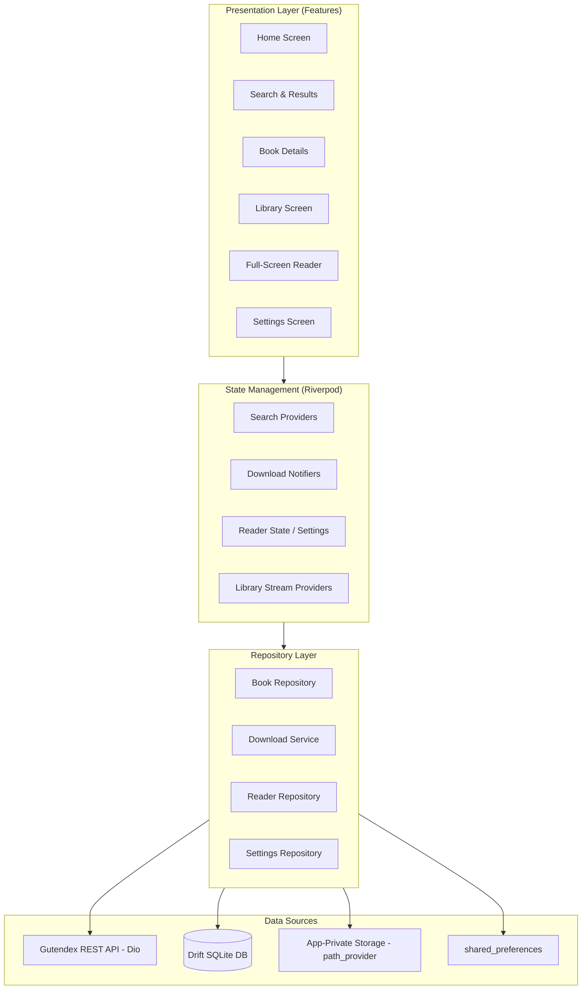

# ARCHITECTURE.md

> How EBuk is built and how its parts connect. AI agents: read this before adding features, creating files, or changing data. Keep it in sync with the real code.
> What the app does lives in `PROJECT_BRIEF.md`. Stack versions and commands live in `AGENTS.md`. Reasons behind choices live in `DECISIONS.md`.

---

## 1. System overview

EBuk is an Android-only Flutter application architected around a feature-first pattern with unidirectional data flow powered by Riverpod.
The app connects to the Gutendex public API solely on user action (never on boot), stores downloaded EPUB files in app-private storage, and indexes books, reading progress, and search caches in a local Drift SQLite database.



## 2. Folder structure

```
ebuk/
├── lib/
│   ├── core/
│   │   ├── constants/       # App-wide constants (app name: EBuk, Gutendex URLs)
│   │   ├── errors/          # Typed failures & domain exceptions
│   │   ├── routes/          # go_router configuration & shell navigation
│   │   ├── strings.dart     # Single source of truth for all UI text (English only)
│   │   └── theme/           # Color tokens (#590907, #E8D2B5, #A5A79B) and ThemeData
│   ├── data/
│   │   ├── api/             # Dio client & Gutendex DTOs
│   │   ├── database/        # Drift database definition, tables, & DAOs
│   │   ├── repositories/    # Implementation of domain repository contracts
│   │   └── services/        # DownloadManager & file storage services
│   ├── domain/
│   │   ├── models/          # Book, LocalBook, ReadingProgress, ReaderSettings
│   │   └── repositories/    # Abstract repository interfaces
│   ├── features/
│   │   ├── book_details/    # Book overview, metadata & download trigger
│   │   ├── home/            # Discovery hub, recent searches, categories
│   │   ├── library/         # Downloaded books grid/list & management
│   │   ├── reader/          # Full-screen EPUB viewer, TOC modal, formatting bar
│   │   ├── search/          # Search bar, results, filters, empty/error states
│   │   └── settings/        # App theme, reading preferences, cache & attribution
│   └── main.dart            # Entry point (ProviderScope, bootstrap)
└── test/                    # Unit, widget, and repository tests
```

**Where things go:**

| If you are adding... | Put it in... |
|----------------------|--------------|
| A screen or UI widget | `lib/features/<feature_name>/presentation/` |
| UI state / Riverpod notifier | `lib/features/<feature_name>/controllers/` or `providers/` |
| API parsing / network calls | `lib/data/api/` |
| SQLite table or query | `lib/data/database/` |
| Pure data model | `lib/domain/models/` |
| User-facing string | `lib/core/strings.dart` |
| Color / Typography token | `lib/core/theme/` |

## 3. Main modules and responsibilities

| Module | Responsibility | Depends on | Must NOT |
|--------|----------------|------------|----------|
| `features/*` | Render UI, bind Riverpod state, handle user inputs | Riverpod providers, `core/strings.dart`, `core/theme` | Call Dio or Drift database directly |
| `data/repositories` | Coordinate data fetching, caching, and persistence | `data/api`, `data/database`, `data/services` | Reference UI widgets |
| `data/database` | Manage local SQLite tables via Drift | SQLite engine | Make network requests |
| `data/services` | Background file download, cancellation, and disk management | `path_provider`, `dio` | Render UI components |

**Layering rule:** UI -> Providers -> Repositories -> Data Sources. Lower layers must never depend on higher layers.

## 4. Database schema (Drift / SQLite)

- **Database:** Local SQLite managed via Drift.
- **Rule:** Schema migrations are strictly handled via Drift schema versions.

### Core Tables

#### `books` (Downloaded and cached books)
| Column | Type | Notes |
|--------|------|-------|
| `id` | Int | Gutenberg Book ID (Primary Key) |
| `title` | Text | Book title |
| `authors` | Text | JSON-encoded or delimited author names |
| `cover_url` | Text (nullable) | Remote cover URL |
| `cover_path` | Text (nullable) | Local cached cover path |
| `file_path` | Text | Local path in app-private storage |
| `file_size` | Int | Size in bytes |
| `downloaded_at` | DateTime | Timestamp when download completed |

#### `reading_progress` (Reading state tracking)
| Column | Type | Notes |
|--------|------|-------|
| `book_id` | Int | Foreign key references `books(id)` (Primary Key) |
| `cfi` | Text | Canonical Fragment Identifier (exact position) |
| `percentage` | Real | 0.0 to 1.0 progress |
| `last_read_at` | DateTime | Timestamp for sorting recently read books |

#### `search_history` (Recent searches for Home screen)
| Column | Type | Notes |
|--------|------|-------|
| `query` | Text | Search term (Primary Key) |
| `searched_at` | DateTime | Timestamp of search |
